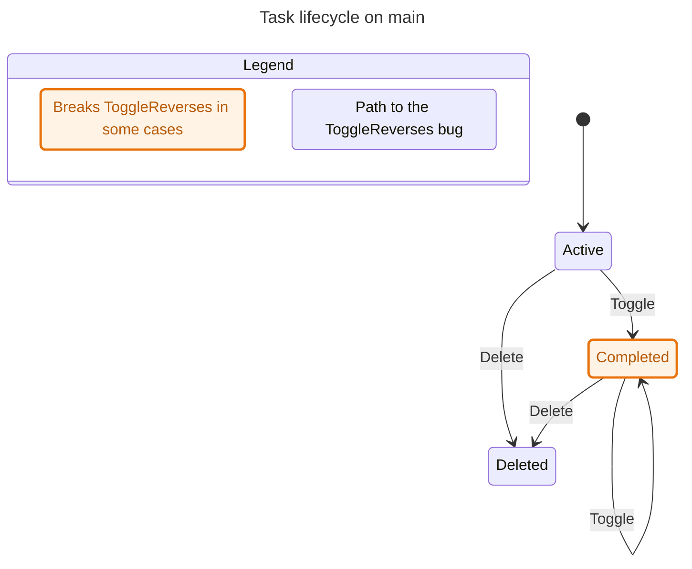

# Task lifecycle on main

The intended lifecycle starts Active. Toggle switches Active to Completed and Completed to Active. Delete from either state ends in Deleted; subsequent requests for that ID return 404. The model below describes the actual toggle update on `main`, which always writes 1. Deleted is an absorbing state in this single-task abstraction.



TLC explored 5 states and 8 steps. `TypeOK` and `NoDeadlock` hold. `ToggleReverses` breaks on the shortest path: 0. Active → 1. Toggle: Completed → 2. Toggle: Completed. The Completed label is marked `mayBreak` because it also represents the valid first toggle. The tool hides three steps that stay within a chart label, including the deleted-state stutter; the failing toggle self-loop is shown.

I replayed the path against the actual `main` API in an isolated archive: creation returned `completed: 0`, then two toggle requests returned `1`, `1`; the second should return `0`. Phase A's separate `pstack/a1-toggle` branch fixes this, but it is not merged into main. This model omits concurrent requests, persistence failures, HTTP response details, and multiple tasks; it is not a proof of those behaviors.

## Reproduce the model

Save the following as `Task.tla`, `Task.cfg`, and `view.mjs` in a scratch directory. With Java 11+ and a TLC jar available, run `TLA2TOOLS=/path/to/tla2tools.jar JAVA=/path/to/java .agents/skills/statechart/scripts/statechart /path/to/Task.tla --config /path/to/Task.cfg --view /path/to/view.mjs --out /path/to/new-output` from the repository root. The built-in installer requires `mise`; the run here used the supported jar fallback.

```tla
---------------- MODULE Task ----------------
EXTENDS Naturals
VARIABLES phase, last, before
vars == <<phase, last, before>>
Init == /\ phase = "active" /\ last = "none" /\ before = "active"
Toggle == /\ phase \in {"active", "completed"}
          /\ before' = phase /\ phase' = "completed" /\ last' = "toggle"
Delete == /\ phase \in {"active", "completed"}
          /\ before' = phase /\ phase' = "deleted" /\ last' = "delete"
Done == /\ phase = "deleted" /\ UNCHANGED vars
Next == Toggle \/ Delete \/ Done
TypeOK == /\ phase \in {"active", "completed", "deleted"}
          /\ before \in {"active", "completed"}
          /\ last \in {"none", "toggle", "delete"}
ToggleReverses == last = "toggle" => phase # before
Spec == Init /\ [][Next]_vars
================================================
```

```text
SPECIFICATION Spec
INVARIANT TypeOK
INVARIANT ToggleReverses
```

```javascript
export const title = 'Task lifecycle on main';
export const state = v => ({active:'Active',completed:'Completed',deleted:'Deleted'})[v.phase];
export const step = (action) => ({Toggle:'Toggle',Delete:'Delete',Done:'Remain deleted'})[action] || action;
```
